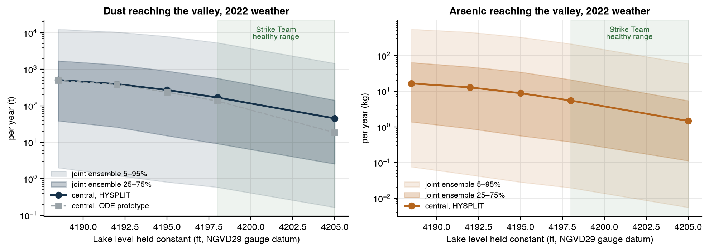
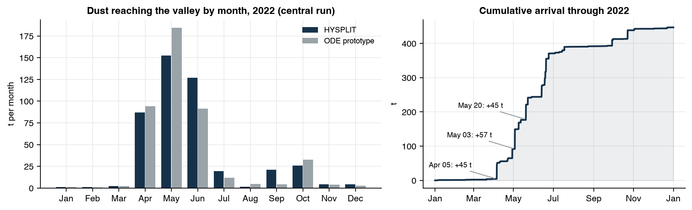
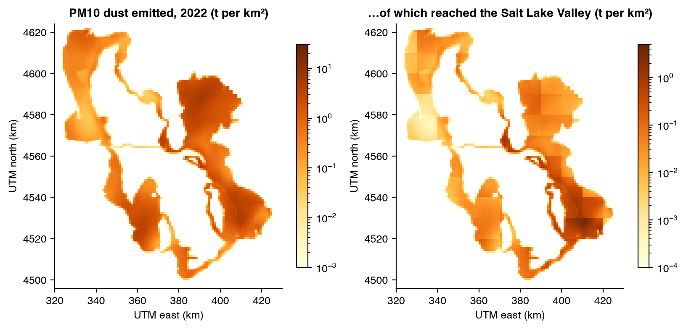
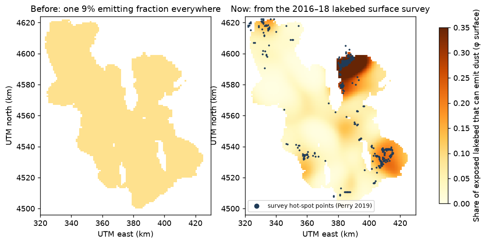
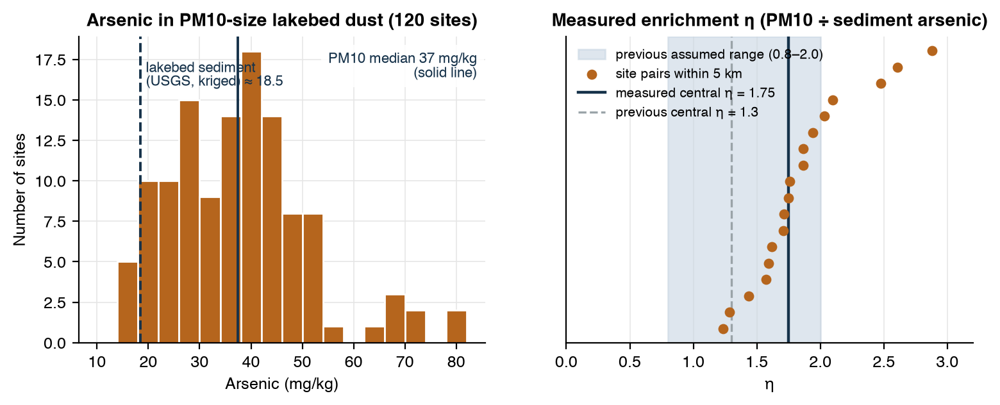
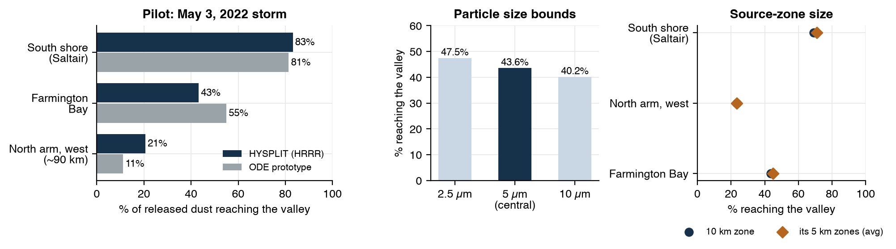
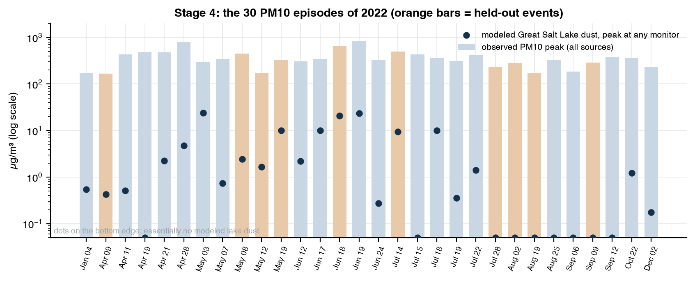
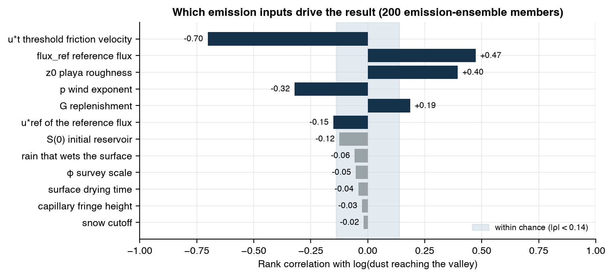
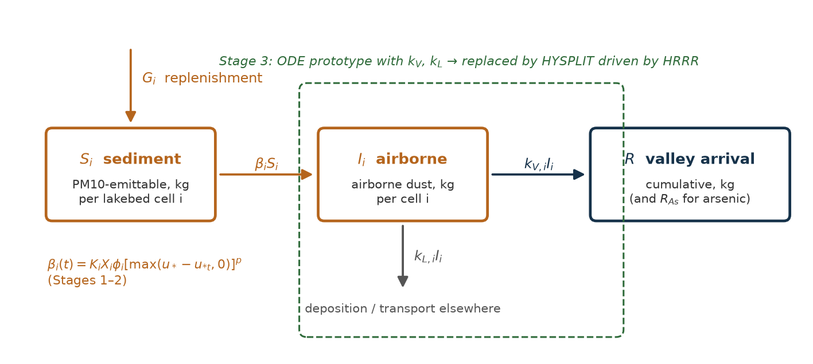

# Great Salt Lake dust model

The Great Salt Lake holds a special place in my heart. It is an important part to the ecosystem where I live, and the lake effect produces the best snow in the world (very important). As severe drought continues to impact the Western USA, many have worried about the GSL and how lower water elevation levels would impact the Salt Lake Valley, where nearly 1 million people live. For this reason, I was curious to know just how dangerous lower lake levels would be with exposed arsenic blowing into the valley. 

The question then is: How much dust and arsenic blows off the exposed bed of the Great Salt Lake and into the Salt Lake Valley, and how does that changes with the lake level? 

The model follows each 1 km patch of lakebed through the year: whether the water has left it, whether it's dry, crusted or snow-covered, and whether the wind is strong enough to lift dust off it. The lifted dust then goes into NOAA's HYSPLIT dispersion model, driven by hourly 3 km HRRR weather, which follows every particle until it enters the valley, settles out, or leaves the region. The outputs are dust and arsenic **arriving in the valley**, in total and hour by hour. It stops there and does not estimate health effects.

Full write-up: **[docs/GSL_Dust_Model_Report.pdf](docs/GSL_Dust_Model_Report.pdf)** (14 pages). The modeling standard it follows is [docs/GSL_Dust_Model_Guide.pdf](docs/GSL_Dust_Model_Guide.pdf).

## What it shows (2022 weather)

### Each foot of lake level matters



These runs keep 2022's hourly weather fixed and change only the lake level. At the November 2022 record low (4,188.5 ft) about **510 t** of PM10 dust reaches the valley in a year. At the top of the Strike Team's healthy range (4,205 ft) it's about **45 t**. The absolute numbers are very uncertain (the shaded bands), but the *drop* isn't: in all 200 ensemble members, arrival falls as the lake rises, by 8–18× from record low to 4,205 ft.

### A few storms do most of the work



82% of the year's lake dust reaches the valley from April to June, and three days (April 5, May 3 and May 20) deliver about a third of it. Most of the year contributes almost nothing. The lakebed only emits when it's dry, not under snow, and the wind clears a threshold. The threshold matters most: emission scales roughly with the cube of how far the wind exceeds it.

### Farmington Bay is the problem child



Left: where dust comes off the lakebed. Right: how much of it ends up in the valley. Bear River Bay emits as much as anywhere, but Farmington Bay and the southeast shore deliver most of what arrives. They combine dust-prone ground with the shortest trip, so more of what they emit arrives before it settles or blows elsewhere.

### The dust-prone ground is patchy



Most of the exposed lakebed is protected by salt or mud crusts. A 2016–18 University of Utah survey recorded crust type, vegetation and visible fine dust at about 5,300 points on the lakebed. We use it to map the share of each square kilometer that can actually emit. The first version of the model assumed a flat 9% everywhere. The survey puts that share near zero over most of the west, 15–25% in Farmington Bay, and above 30% in parts of Bear River Bay.

### Airborne dust is richer in arsenic than the mud it came from



The same study blew lakebed soil from 120 sites through a PM10 inlet and measured what came out. The dust-sized fraction averages **37 mg/kg** arsenic, about twice the ~18.5 mg/kg in lakebed sediment. Comparing site pairs within 5 km gives an enrichment factor of **1.75** (the model previously assumed 1.3). In 2022 that comes to about **15 kg** of arsenic reaching the valley.

### Straight-line thinking misses dust that takes the long way



The first prototype assumed dust reaches the valley only if the wind *at the source* points at it. HYSPLIT follows real trajectories. For a zone on the far north arm during the May 3 storm, the prototype sent 11% of its dust to the valley. HYSPLIT sent 21%, because the flow curved on the way. At high lake levels, where only the outer bays are still exposed, this makes HYSPLIT's totals up to 2.5× larger. Particle size barely matters: 2.5, 5 and 10 µm dust change the year's total by about ±3%.

### Where the model falls short: the monitors



We checked the model against 30 PM10 pollution episodes in 2022 at five Wasatch Front monitors. Ten episodes and two monitors were held out before any comparison, and nothing is tuned to the monitors. **The timing is right:** the model's biggest lake-dust days are the spring and June windstorms, and it puts essentially no lake dust in the July–September episodes, which were probably smoke or other dust sources. **The amounts are not:** modeled lake dust peaks at 10–24 µg/m³ while the monitors read 300–800 µg/m³. Part of that gap is other sources, but the model's emissions are almost certainly too low.

### Why: one missing dataset



Nearly all the uncertainty comes from four numbers in the emission law. The top two are the wind threshold (u\*<sub>t</sub>) and the reference flux (flux_ref). All four are measured with a PI-SWERL, a portable wind-erosion instrument. Great Salt Lake PI-SWERL data exist (a University of Utah thesis and the Perry lab's survey) but aren't public, so the model uses values from a New Mexico playa. That data would tighten everything above. Because the transport is stored per zone, recalibrating takes minutes and needs no new HYSPLIT runs.

## How it works



For each 1 km lakebed cell, emittable sediment **S** is lifted at rate βS when the wind beats the threshold:

β = K · X · φ · max(u\* − u\*<sub>t</sub>, 0)<sup>p</sup>

- **X** is the exposed fraction of the cell, from the lake gauges and 20 m lakebed terrain. It reproduces USGS's official area-vs-elevation tables within 0.15%.
- **φ** is erodibility: the survey's dust-prone share, zeroed when the ground is wet, snow-covered or near the waterline.
- **u\*** is friction velocity from HRRR winds over smooth playa.

Some details that took real work:

- **HRRR into HYSPLIT, without the terabytes.** NOAA's ready-made HYSPLIT weather is about 5 TB for a year. Instead, each hour of HRRR is fetched field by field, cropped to a 450 km box around the lake, written in HYSPLIT's own format, and discarded. That's 2.4 GB downloaded and 65 MB kept per day. HYSPLIT's tools confirm the files are read correctly, down to the ground elevation at Salt Lake City airport.
- **Run HYSPLIT once, reuse it everywhere.** Dust transport is linear in mass. So each of 92 lakebed zones runs once for the whole year with a unit emission, and any scenario or ensemble member is just emissions × stored arrivals: 9 seconds instead of a fresh HYSPLIT run. Direct HYSPLIT runs over the validation episodes agree with this shortcut to a median of 0.7%.
- **Count each particle once.** A particle's mass counts the minute it first enters the valley, and never again. That required decoding how HYSPLIT renumbers particles, then checking the decoding every minute. Hourly snapshots would miss 15% of entries on a windy day.
- **Only simulate hours that can matter.** In 75% of zone-hours the wind is below the lowest threshold any parameter set allows, so no dust can lift. HYSPLIT releases particles only in the other 25%.

## Data

| Source | Used for |
|---|---|
| USGS lake gauges 10010000 (Saltair) and 10010100 (Saline) | Lake level by arm |
| USGS Great Salt Lake topobathymetric model and elevation–area tables | Exposed lakebed |
| NOAA HRRR, hourly, 3 km | Winds, rain and snow for emission; full 3-D weather for HYSPLIT |
| NOAA HYSPLIT v5.4.2 | Dust transport and deposition |
| Perry, Crosman & Hoch (2019), *Great Salt Lake Dust Plume Study* | Surface survey (erodibility); PM10 arsenic (enrichment) |
| USGS dust and sediment data releases (2018–19, 2022) | Lakebed sediment arsenic |
| EPA AQS hourly PM10, 2022 | Validation |
| Van Pelt et al. (2020), Lordsburg Playa NM | Emission-law parameters, as a stand-in for missing GSL data |

## Running it

```bash
python3 -m venv .venv && source .venv/bin/activate && pip install -e ".[dev]"
python -m pytest                                   # 16 tests
python scripts/stage1_exposure.py                  # terrain and exposure (needs the USGS terrain files in data/raw/tbdem/)
python scripts/fetch_hrrr.py                       # hourly HRRR on the 1 km grid, for emissions
python scripts/extract_perry_report.py             # survey and PM10 arsenic tables from the Perry report PDF
python scripts/run_hysplit_transfer.py             # HYSPLIT for every zone, all of 2022 (resumable; --start/--end to run date ranges in parallel)
python scripts/run_episodes.py                     # validation runs at the PM10 monitors
python scripts/run_model.py --transport hysplit    # central run, lake-level scenarios, 200-member ensembles
python scripts/make_report_figures.py              # figures for the report and this README
```

HYSPLIT comes from [NOAA READY](https://www.ready.noaa.gov/HYSPLIT.php) (free, after accepting its use agreement) and installs to `~/hysplit`. The terrain (ScienceBase item `646d0ed2d34ee02593fb50a7`) needs a ScienceBase sign-in. Data, results and logs aren't in git; the scripts regenerate them. On a 16-core Mac the HYSPLIT year takes about 14 hours, mostly downloading weather, and peaks at about 5 GB of disk.

## Code map

| Stage | Module | What it does |
|---|---|---|
| 1 | `lake_levels.py`, `datums.py` | Lake level by arm; NGVD29 → NAVD88 |
| 1 | `grid.py`, `boundaries.py`, `exposure.py` | 1 km grid, valley boundary, exposed fraction X |
| 1 | `hrrr.py` | Hourly HRRR on the lattice |
| 2 | `emission.py`, `erodibility.py`, `surface_survey.py` | Threshold law; physics φ from the field survey |
| 2 | `chemistry.py` | Arsenic kriging |
| 3 | `ode.py`, `transfer.py` | First-order prototype (kept for comparison) |
| 3 | `hrrr_arl.py`, `arl.py` | HRRR → HYSPLIT weather files |
| 3 | `hysplit_run.py`, `first_entry.py`, `hysplit_transport.py` | Per-zone HYSPLIT runs, particle tracking, superposition |
| 4 | `episode_runs.py`, `validation.py`, `validation/heldout_design.json` | Direct runs at monitors; fixed held-out design |
| all | `model.py`, `params.py`, `decisions.py` | The chain; parameters with sources; open choices |

Choices in `decisions.py` are provisional until confirmed. Parameters marked `interim=True` in `params.py` are stand-ins for Great Salt Lake field data.
